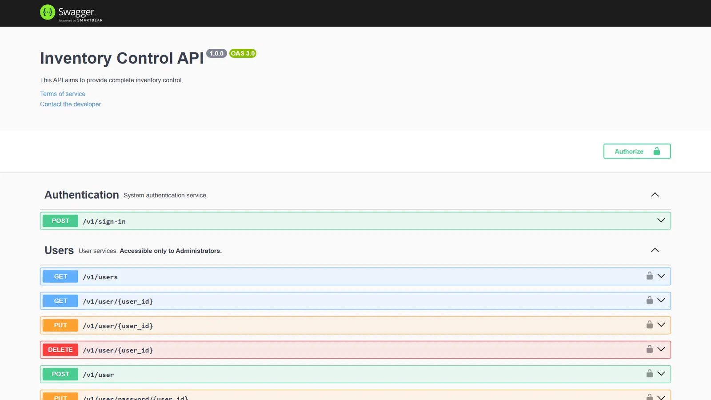

# Controle de Estoque e Vendas — API em Node.js

API REST com autenticação JWT, perfis de acesso, upload de imagens e documentação Swagger.

<p align="center">
  
</p>

---

## Sumário

- [Visão geral](#visão-geral)
- [Stack e versões](#stack-e-versões)
- [Estrutura do projeto](#estrutura-do-projeto)
- [Primeiros passos](#primeiros-passos)
- [Variáveis de ambiente](#variáveis-de-ambiente)
- [Scripts](#scripts)
- [Rotas principais](#rotas-principais)
- [Projetos relacionados](#projetos-relacionados)
- [Autor](#autor)

---

## Visão geral

API do sistema de controle de estoque, consumida pelos front-ends em [React](https://github.com/marcospsdev/Inventory-Control-in-React) e [Angular](https://github.com/marcospsdev/Inventory-Control-in-Angular). Faz o CRUD de usuários, categorias e produtos (com upload de imagem), lista produtos por categoria e registra vendas com baixa automática no estoque. O acesso é controlado por JWT e por perfil (Administrador, Operador e Vendedor).

Principais funcionalidades:

- Autenticação com JWT e senhas com bcrypt
- Perfis de acesso validados nos services
- Upload de imagem de produto com Multer
- Vendas com baixa automática no estoque
- Documentação interativa com Swagger em `/api-docs`
- Prisma ORM com SQLite

Concluído em 08/2025.

---

## Stack e versões

| Categoria | Tecnologia | Versão |
| --- | --- | --- |
| Linguagem | TypeScript | 4.9 |
| Back-end | Express | 4.18 |
| Banco de dados | Prisma ORM + SQLite | 6.0 |
| Autenticação | bcrypt + JWT | 2.4 / 9.0 |
| Upload | Multer | 1.4 |
| Documentação | Swagger UI | 5.0 |
| Qualidade | Prettier | 3.4 |

As versões exatas estão no `package.json`.

---

## Estrutura do projeto

```
src/
  @types/
    express/
  config/
    multer.ts
  controllers/
    category/
    product/
    sale/
    user/
  middlewares/
    permissions.ts
  models/
    interfaces/
  prisma/
    index.ts
  services/
    category/
    product/
    sale/
    user/
  routes.ts
  server.ts
```

---

## Primeiros passos

### Pré-requisitos

- Node.js 18 ou mais recente
- npm

### Instalação

```bash
git clone https://github.com/marcospsdev/Stock-Control-API-in-Node.js.git
cd Stock-Control-API-in-Node.js
npm install
echo 'DATABASE_URL="file:./dev.db"' > .env   # e acrescente JWT_SECRET
npx prisma db push       # cria as tabelas no SQLite
npx prisma db seed       # dados iniciais (opcional)
npm run dev              # http://localhost:3333
```

A documentação fica em http://localhost:3333/api-docs.

---

## Variáveis de ambiente

| Variável | Obrigatória | Descrição |
| --- | --- | --- |
| `DATABASE_URL` | Sim | Conexão do Prisma (ex.: `file:./dev.db`) |
| `JWT_SECRET` | Sim | Segredo usado para assinar os tokens JWT |

---

## Scripts

| Comando | Descrição |
| --- | --- |
| `yarn dev` | Sobe a API com recarga automática (ts-node-dev) |

---

## Rotas principais

Todas sob o prefixo `/v1`:

- `POST /sign-in`: login
- `/user`, `/users`, `/user/:user_id`, `/user/password/:user_id`: usuários
- `/categories`, `/category`, `/category/:category_id`: categorias
- `/products`, `/product`, `/product/:product_id`, `/products/:category_id`: produtos
- `PUT /sale/:product_id`: venda com baixa no estoque

As imagens enviadas ficam em `tmp/` e são servidas em `/files`.

---

## Projetos relacionados

- [Stock-Control-API-in-Node.js](https://github.com/marcospsdev/Stock-Control-API-in-Node.js): API REST em Node.js
- [Inventory-Control-in-React](https://github.com/marcospsdev/Inventory-Control-in-React): front-end em React
- [Inventory-Control-in-Angular](https://github.com/marcospsdev/Inventory-Control-in-Angular): front-end em Angular

---

## Autor

**Marcos Paulo** · Desenvolvedor Full-Stack

- LinkedIn: [in/marcospsdev](https://www.linkedin.com/in/marcospsdev)
- GitHub: [@marcospsdev](https://github.com/marcospsdev)
